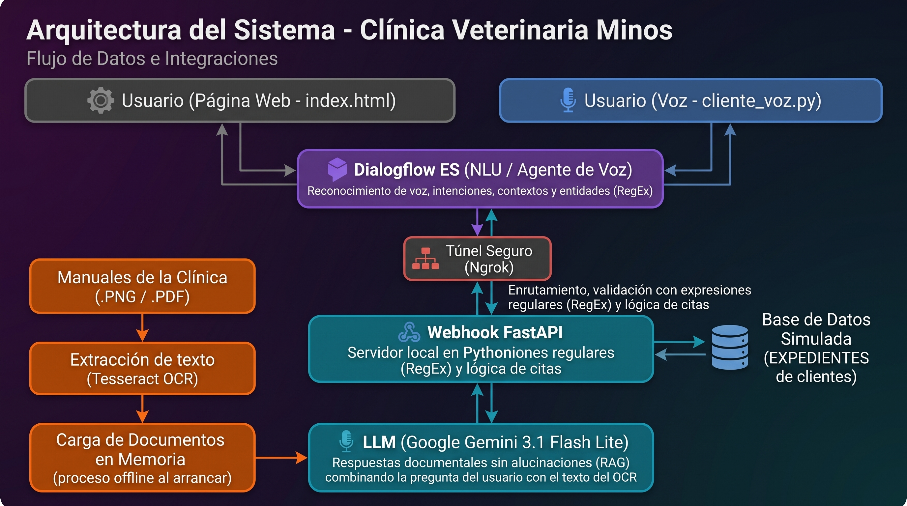
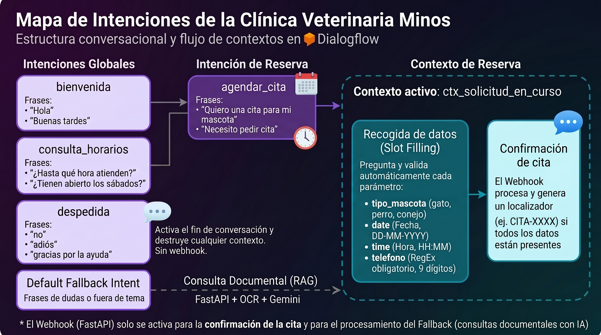

# Asistente Virtual - Clínica Veterinaria Minos

### 1. Descripción del caso de uso
El proyecto consiste en un asistente virtual (recepcionista) omnicanal para la Clínica Veterinaria Minos, capaz de interactuar mediante chat de texto y voz. Su objetivo principal es automatizar la gestión de reservas de citas extrayendo datos clave (tipo de mascota, fecha, hora y teléfono), validar la información mediante un flujo de confirmación con el usuario, y resolver dudas operativas estáticas (como horarios de atención). Además, mediante un sistema RAG (Retrieval-Augmented Generation), el agente puede responder a consultas veterinarias basándose exclusivamente en los manuales clínicos de la empresa procesados por OCR, evitando alucinaciones generadas por la Inteligencia Artificial.

---

### 2. Diagramas de la Arquitectura

---

### 3. Entidades Personalizadas
Para extraer la información estructurada del usuario, se desarrollaron las siguientes entidades:
*   **`@tipo_mascota`**: Entidad de mapeo de texto que incluye valores principales (perro, gato, conejo) y sus respectivos sinónimos (can, cachorro, michi, minino, etc.) para abarcar el lenguaje natural del usuario.
*   **`@telefono`**: Entidad basada en Expresión Regular (RegEx) configurada con el patrón `[0-9]{9}`. Garantiza que el sistema solo extraiga números de teléfono de exactamente 9 dígitos.

---

### 4. Lista de intenciones y su propósito
*   **`Default Welcome Intent` (Bienvenida):** Saluda al usuario y le ofrece el catálogo de servicios de la clínica al iniciar la conversación. No utiliza webhook.
*   **`agendar_cita`:** Gestiona el flujo principal de reservas mediante *slot filling*. Recopila obligatoriamente la mascota (`@tipo_mascota`), fecha (`@sys.date`), hora (`@sys.time`) y contacto (`@telefono`). Utiliza el webhook para enviar la información al backend y activa el contexto de salida `esperando_confirmacion`.
*   **`agendar_cita - confirmacion_si` / `confirmacion_no`:** Intenciones de seguimiento (*follow-up*) atadas al contexto `esperando_confirmacion`. Permiten al usuario revisar el resumen de su cita y aceptarla (confirmando la reserva e inyectando SSML para una pronunciación correcta de fechas por voz) o rechazarla (cancelando la solicitud actual).
*   **`consulta_horarios`:** Responde de forma estática (sin webhook) sobre los días y horas de apertura de la clínica, resolviendo FAQs al instante.
*   **`cierre_conversacion` (Despedida):** Atrapa expresiones de cierre (ej. "no", "adiós", "gracias"). Tiene activada la propiedad `endInteraction: true` en Dialogflow para destruir cualquier contexto activo y resetear la memoria del bot.
*   **`Default Fallback Intent` (RAG):** Se activa cuando el bot no reconoce la intención del usuario. Tiene el webhook activado para redirigir la consulta al servidor FastAPI, el cual busca coincidencias en los manuales clínicos y utiliza el LLM para redactar una respuesta útil.

---

### 5. Decisiones técnicas tomadas
*   **Motor NLU (Dialogflow ES):** Elegido por su robusto sistema de extracción de entidades de sistema (fechas, horas), manejo automático de contextos (*slot filling*) y la facilidad para crear flujos de confirmación sin sobrecargar el código backend.
*   **Backend (FastAPI):** Se utilizó por su asincronía y rapidez para procesar los *payloads* del webhook en formato JSON.
*   **Extracción de Documentos (Tesseract OCR):** Permite procesar manuales de la clínica en formatos de imagen (.PNG/.JPEG) y PDF de forma *offline* al arrancar el servidor, cargando el texto en memoria para realizar consultas rápidas sin depender de bases de datos vectoriales externas.
*   **Modelo de Lenguaje (Gemini 3.1 Flash Lite):** Integrado para el sistema RAG por su bajo tiempo de latencia y alta adherencia a las instrucciones del sistema (*System Prompt*), lo que garantiza respuestas precisas limitadas al contexto proporcionado y evita inventar información médica.

---

### 6. Estructura del Proyecto

| Archivo / Directorio | Descripción |
| :--- | :--- |
| **`main.py`** | Archivo central del servidor backend construido con FastAPI. Contiene los *endpoints* que procesan los *webhooks* de Dialogflow y gestionan el enrutamiento del sistema RAG. |
| **`ocr.py`** | Módulo encargado de la extracción de texto a partir de imágenes de los manuales clínicos utilizando Tesseract OCR. |
| **`cliente_voz.py`** | Script interactivo para ejecutar en la terminal que permite probar el asistente conversacional mediante voz (utilizando las capacidades nativas de STT y TTS de Dialogflow). |
| **`index.html`** | Interfaz web front-end que contiene el widget de chat integrado para interactuar con el asistente vía texto. |
| **`documentos/`** | Directorio destinado a almacenar la base de conocimiento de la clínica (imágenes de los manuales) que será leída por el script de OCR. |
| **`requirements.txt`** | Archivo que lista todas las dependencias y librerías de Python necesarias para ejecutar el entorno (`fastapi`, `google-cloud-dialogflow`, etc.). |
| **`.env`** | Archivo de configuración local (ignorado en repositorios públicos) que almacena de forma segura las variables de entorno, como la clave de API de Gemini (`GOOGLE_API_KEY`). |
| **`veterinariabot-*.json`** | Archivo de clave de cuenta de servicio (*Service Account*) para autenticar las peticiones locales con el proyecto de Google Cloud/Dialogflow. |
| **Imágenes (`.jpeg`)** | Esquemas visuales estáticos (`Diagrama_de_Arquitectura` y `Mapa_de_Intenciones`) que ilustran la topología del sistema y el flujo de las intenciones. |

---

### 7. Instrucciones paso a paso para ejecutar el proyecto

A continuación, se detallan las instrucciones parra pueda ejecutar el proyecto en su máquina local.

#### Paso 1: Clonar el repositorio y acceder a la carpeta
Abre tu terminal (Símbolo del sistema, PowerShell o terminal de Linux/Mac) y ejecuta:
1. `git clone <URL_DE_TU_REPOSITORIO>` (o descarga el ZIP y extráelo).
2. Entra en la carpeta del proyecto: `cd nombre_de_la_carpeta`

#### Paso 2: Crear y activar un entorno virtual
Es una buena práctica instalar las dependencias en un entorno aislado para no interferir con otras versiones de Python en tu sistema.
*   **En Windows (usando PowerShell):**
    1. Crea el entorno: `python -m venv venv_win`
    2. Actívalo: `.\venv_win\Scripts\activate`
    *(Nota: Si te da un error de permisos en PowerShell, ejecuta primero `Set-ExecutionPolicy Unrestricted -Scope CurrentUser`).*
*   **En Linux o macOS:**
    1. Crea el entorno: `python3 -m venv .venv`
    2. Actívalo: `source .venv/bin/activate`

Sabrás que está activado porque el nombre del entorno aparecerá entre paréntesis al inicio de tu terminal, por ejemplo: `(venv_win)`.

#### Paso 3: Instalar las dependencias
Con el entorno activado, instala todas las librerías necesarias ejecutando:
`pip install -r requirements.txt`

#### Paso 4: Configurar credenciales y variables de entorno
El proyecto necesita conectarse a los servicios de IA de Google.
1. Crea un archivo de texto en la raíz del proyecto y nómbralo exactamente `.env` (asegúrate de que no termine en `.txt`).
2. Abre el archivo y añade tu clave de Gemini:
   `GOOGLE_API_KEY="tu_clave_de_gemini_aqui"`
3. Coloca el archivo JSON con las credenciales de tu cuenta de servicio de Google Cloud (ej. `veterinariabot-xxx.json`) dentro de la carpeta del proyecto.
4. En el mismo archivo `.env`, añade la ruta a tu archivo JSON para que Dialogflow pueda autenticarse:
   `GOOGLE_APPLICATION_CREDENTIALS="nombre_de_tu_archivo.json"`

#### Paso 5: Iniciar el servidor local (Backend)
En la misma terminal donde activaste el entorno virtual, arranca el servidor de FastAPI:
`uvicorn main:app --reload --port 8000`
*(Deja esta terminal abierta y minimizada; es el "cerebro" de la aplicación).*

#### Paso 6: Exponer el puerto al exterior (Ngrok)
Dialogflow está en la nube, por lo que necesita una URL pública para hablar con tu servidor local.
1. Abre una **nueva** ventana de terminal.
2. Ejecuta Ngrok apuntando al puerto de tu servidor:
   `ngrok http 8000`
3. Verás una pantalla negra con una URL segura (Forwarding). Copia la dirección que empieza por `https://...` (ej. `https://1234-abcd.ngrok-free.app`). Deja esta terminal abierta.

#### Paso 7: Conectar Dialogflow al Backend
1. Entra a tu consola web de Dialogflow ES y ve a la sección **Fulfillment** en el menú izquierdo.
2. Habilita el interruptor de **Webhook**.
3. Pega la URL de Ngrok que acabas de copiar y añádele `/webhook` al final. Debería quedar así: `https://1234-abcd.ngrok-free.app/webhook`.
4. Ve al final de la página y haz clic en **Save**.

#### Paso 8: Uso de las interfaces de usuario
Ahora puedes probar tu asistente de dos formas distintas:
*   **Chat de texto (Interfaz Web):** Abre el archivo `index.html` en cualquier navegador web (Chrome, Edge, etc.) haciendo doble clic sobre él. Verás un widget de chat integrado listo para conversar.
*   **Chat de Voz (Terminal):** Abre una nueva terminal, activa tu entorno virtual (ver Paso 2), asegúrate de que las variables de entorno están cargadas y ejecuta: `python cliente_voz.py`. Habla por el micrófono de tu ordenador para interactuar con el bot y escucha sus respuestas con voz sintetizada.

---

### 8. Decisiones Arquitectónicas y Manejo de Errores (Justificación Técnica)

Este proyecto ha sido diseñado tomando decisiones conscientes sobre el procesamiento de datos y la arquitectura del flujo conversacional para garantizar la robustez del sistema en un entorno clínico veterinario.

#### 1. Preprocesado de imagen para OCR
Los manuales y documentos veterinarios suelen ser escaneos o fotos con variaciones de luz. Para maximizar la precisión de Tesseract en el archivo `ocr.py`, no analizamos la imagen en crudo. Utilizamos la librería **Pillow (PIL)** para convertir la imagen a escala de grises (`imagen.convert("L")`) antes de pasarla al OCR. Al eliminar la información de color, aumentamos el contraste entre el texto y el fondo, facilitando enormemente la lectura a Tesseract. Además, configuramos Tesseract con el parámetro `--psm 6`, indicándole que asuma un bloque uniforme de texto, lo que previene que la lectura se fragmente.

Durante la fase de desarrollo, se realizaron pruebas de estrés modificando el modo de segmentación de página de Tesseract (`--psm`). Los resultados evidenciaron que el modo automático por defecto (`--psm 3`) tendía a fragmentar los párrafos de forma errática al intentar interpretar membretes, sellos o márgenes irregulares en los manuales clínicos. Asimismo, el modo de columna única (`--psm 4`) desordenaba la lectura de las listas de síntomas o viñetas. Finalmente, se consolidó el uso de `--psm 6` (bloque uniforme de texto) ya que demostró ser la configuración más estable para mantener la cohesión natural de los párrafos, un factor crítico para que el LLM (Gemini) reciba el contexto ordenado y sin cortes abruptos.

#### 2. Tratamiento de errores de OCR
Tesseract es propenso a cometer errores de transcripción (por ejemplo, confundir letras con números de forma visual). Para mitigar esto, aplicamos dos estrategias:
*   **Corrección Heurística (Fuerza Bruta):** Hemos implementado una función `normalizar_ocr()` que intercepta el texto crudo y corrige de forma preventiva las confusiones más clásicas (cambiando la letra 'O' por el número '0', la 'l' por '1', la 'S' por '5', etc.) antes de buscar patrones.
*   **Delegación Semántica al LLM:** Para la generación de respuestas en el RAG, delegamos la tolerancia a fallos al modelo fundacional (Gemini). Al enviar el texto sucio del OCR como contexto dentro del *prompt*, la alta capacidad de comprensión semántica del LLM le permite deducir la palabra correcta basándose en el contexto médico, ignorando las erratas tipográficas menores y devolviendo una respuesta limpia al usuario.

#### 3. Descarte de la Knowledge Base nativa de Dialogflow
Se evaluó el uso de los *Knowledge Connectors* de Dialogflow ES, pero fueron descartados por las siguientes razones:
*   **Respuestas extractivas vs. generativas:** La KB de Dialogflow se limita a buscar el párrafo que mejor encaja y devolverlo literalmente. Un entorno veterinario requiere empatía y síntesis.
*   **Falta de razonamiento:** Si la clínica requiere cruzar variables, la KB no puede deducir la respuesta. Al construir nuestro propio backend (`main.py`) conectando Dialogflow con Gemini mediante un *webhook*, el bot puede analizar el texto, sintetizar información de múltiples manuales y redactar una respuesta natural, estructurada y amable, cumpliendo con las directrices del *system prompt*.

#### 4. Gestión de latencia y fallos del modelo
Dialogflow impone un límite estricto de **5 segundos de espera** para recibir respuesta de un *webhook*. Además, el `cliente_voz.py` graba audios en ráfagas exactas de 5 segundos. Las llamadas a APIs externas (LLMs) a veces sufren latencia.
*   **Control de Excepciones (Try-Except):** En el servidor FastAPI (`main.py`), la llamada a Gemini está envuelta en un bloque `try-except`. Si la API de Google Cloud falla (ej. error 500, *timeout* o problemas de conexión), el servidor captura la excepción, evita colgarse y devuelve un payload JSON controlado: *"En este momento tengo problemas técnicos para consultar los manuales. ¿Te paso con recepción?"*.
*   **Fallback Natural:** Si no se encuentra documentación relevante en el vector de búsqueda, el sistema no llama al LLM, ahorrando tokens y tiempo, y devuelve una respuesta programada rápida ofreciendo derivar al usuario a un veterinario humano.

---

### 9. Video explicativo del proyecto

Nombre del video: VIDEO_veterinaria_bot.mp4